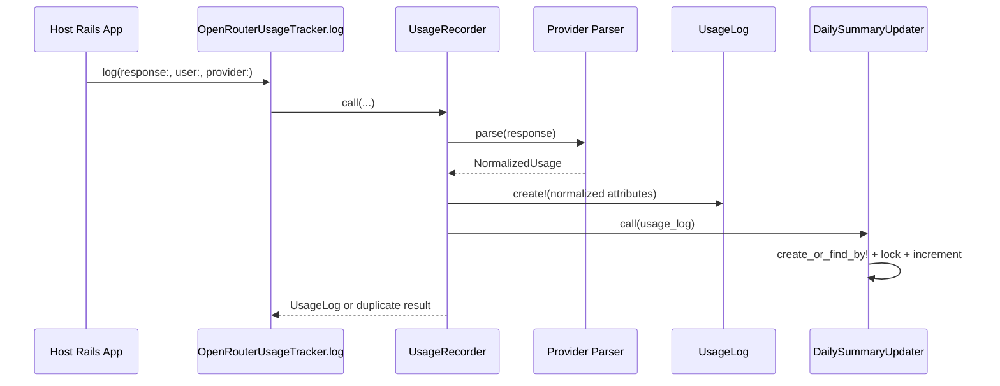

# Architecture Guide

This guide is for contributors who need to understand how the gem fits together before changing code.

## Business Purpose

`open_router_usage_tracker` records user-scoped LLM API usage for Rails apps. The business promise is simple: every successful provider request that matters to billing, limits, or auditability should become accurate, queryable usage data.

The gem keeps host apps away from provider-specific accounting by normalizing raw responses into:

- `UsageLog`: one durable row per provider request.
- `DailySummary`: fast per-user/day/provider/model aggregates.
- `Trackable`: query helpers for user-like models.

## Core Flow

## File Map

- Public API: `lib/open_router_usage_tracker.rb` exposes configuration and includes `Adapter::Base`; `adapter/base.rb` delegates logging to persistence.
- Configuration and cost: `configuration.rb` stores app-owned pricing and raw response redaction; `cost_calculator.rb` applies configured pricing only when parsed usage has no provider/manual cost.
- Providers: `providers/registry.rb` maps provider names to parser classes; each parser returns `NormalizedUsage`; `BaseParser` holds shared response-key validation helpers.
- Persistence: `persistence/usage_recorder.rb` owns the transaction, duplicate policy, raw response redaction, and instrumentation; `daily_summary_updater.rb` owns aggregate updates under row lock.
- Models: `UsageLog` stores detailed request accounting; `DailySummary` stores fast aggregates; `Trackable` adds associations and query helpers to host app models.
- Generators: install generators create v2 tables; `upgrade_v2` migrates existing v1 installs from prompt/completion/cost naming to input/output/cost metadata.
- Maintenance: `DailySummaryRebuilder` recomputes summaries from logs; `RawResponsePruner` clears old raw responses while preserving normalized accounting data.

## Parser Contract

Provider parsers must return `OpenRouterUsageTracker::NormalizedUsage` with:

- `model`, `request_id`, `input_tokens`, `output_tokens`, `total_tokens`
- cache and reasoning counters, defaulting to zero
- `cost_amount`, `cost_currency`, `cost_source`
- `details` for normalized provider-specific metadata
- `raw_usage_response` for optional audit storage

Malformed provider responses should raise `OpenRouterUsageTracker::ParseError` before any database write. This keeps bad accounting data out of both logs and summaries.

## Persistence Invariants

- `provider` + `request_id` is unique for usage logs.
- Duplicate policy defaults to `:raise`; supported alternatives are `:return_existing` and `:ignore`.
- Daily summaries are keyed by `user`, `day`, `provider`, and `model`.
- Summary updates run under a row lock and increment only from a successfully created usage log.
- `occurred_at` determines the summary day.
- `usage_details` is retained even when raw response storage is disabled.
- Provider cost wins over configured pricing; manual response cost wins over configured pricing.

## Adding Or Changing A Provider

1. Add or update a provider fixture under `test/fixtures/provider_responses/`.
2. Update the provider parser under `lib/open_router_usage_tracker/providers/`.
3. Preserve the `NormalizedUsage` contract and raise `ParseError` for missing required fields.
4. Add parser contract tests for the new response shape.
5. Add end-to-end logging coverage if persistence or summary behavior changes.
6. Update `docs/usage.md` if provider keys or behavior change.

## Summary Rebuilds

`DailySummaryUpdater` handles normal writes. `DailySummaryRebuilder` exists for migrations, parser fixes, or data repair:

- Full rebuild deletes all summaries, then recreates them from all usage logs.
- Scoped rebuild deletes and recreates only buckets represented by the supplied usage-log scope.
- Scoped rebuild scopes should include complete buckets; partial scopes intentionally produce partial summaries for those buckets.

## Testing Map

- Provider contracts: `test/providers/provider_parser_contract_test.rb`
- Registry lookup: `test/providers/registry_test.rb`
- End-to-end logging: `test/open_router_usage_tracker_test.rb`
- Trackable helpers: `test/models/concerns/open_router_usage_tracker/trackable_test.rb`
- Usage log validations: `test/models/open_router_usage_tracker/usage_log_test.rb`
- Summary aggregation: `test/models/open_router_usage_tracker/daily_summary_test.rb`
- Generators: `test/generators/install_generator_test.rb`
- Maintenance: `test/maintenance_test.rb`
